<!-- Architecture documentation. Keep assets/ beside this file when publishing. -->
# Database-Driven Multilingual Response Composition

### Hierarchical Metadata · Recursive Tree Interpretation · Runtime Data Binding · Server-Driven Presentation

`Java / Spring` · `PostgreSQL / JSONB` · `Jackson` · `DFS` · `i18n`

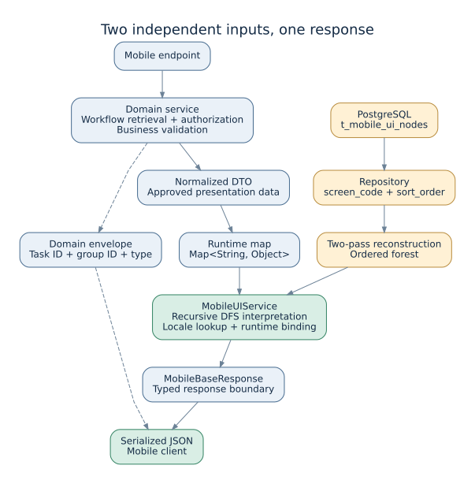

*Figure 1. High-level architecture reconstructed from the supplied Java implementation, database migrations, and merge request description.*

> **Architectural thesis:** The backend does not merely translate interface labels. It interprets a persistent hierarchical definition of the presentation contract, binds authorized business data to that definition, and materializes a localized, structured API response.

> [!NOTE]
> This document distinguishes **observed implementation**, **formal analysis**, and **proposed improvements**. The source excerpts demonstrate time deposit rollover integration and initial placement configuration. The complete repository, client implementation, DTO annotations, test results, and production measurements were not provided. Examples use synthetic financial data; architectural recommendations are not claims of existing functionality.

## Navigation

[Executive summary](#1-executive-summary) · [Architecture](#4-architecture-and-execution-flow) · [Database model](#5-persistent-configuration-model) · [Tree reconstruction](#8-flat-to-tree-reconstruction) · [DFS](#9-recursive-depth-first-interpretation) · [Complexity](#10-computational-complexity) · [Multilingual design](#11-internationalization-and-localization) · [Production readiness](#16-production-hardening)

<details>
<summary><b>Expand the full table of contents</b></summary>

| Foundations | Implementation | Engineering evaluation |
|---|---|---|
| [1. Executive summary](#1-executive-summary) | [7. Domain integration](#7-domain-integration-and-runtime-binding) | [13. Design principles](#13-software-engineering-principles) |
| [2. Problem statement](#2-problem-statement) | [8. Tree reconstruction](#8-flat-to-tree-reconstruction) | [14. Alternatives](#14-architectural-alternatives-and-trade-offs) |
| [3. Architectural classification](#3-architectural-classification) | [9. DFS interpretation](#9-recursive-depth-first-interpretation) | [15. Scalability](#15-scalability-and-performance) |
| [4. Architecture](#4-architecture-and-execution-flow) | [10. Complexity](#10-computational-complexity) | [16. Production hardening](#16-production-hardening) |
| [5. Database](#5-persistent-configuration-model) | [11. Localization](#11-internationalization-and-localization) | [17. Security](#17-security-and-financial-integrity) |
| [6. Node semantics](#6-hierarchical-model-and-node-semantics) | [12. Output contract](#12-representative-output-and-contract-boundaries) | [18. Testing](#18-testing-and-verification) |
| | | [19. Governance](#19-configuration-governance-and-observability) |
| | | [20. Evolution](#20-evolution-roadmap-and-conclusion) |

</details>

---

## 1. Executive summary

This implementation introduces a dynamic, database-driven response generation mechanism for configurable multilingual mobile Task Details and Status Details interfaces. Rather than encoding each response hierarchy as a sequence of hardcoded Java DTO builders, it models presentation components as persistent configuration nodes. The service loads a screen-specific configuration, reconstructs a hierarchical structure, recursively evaluates its nodes, resolves language-dependent metadata, and binds runtime transaction values to a supported response contract.

The design establishes an architectural boundary between domain data acquisition and presentation composition. Domain services remain responsible for retrieving workflow information, validating transaction integrity and organizational access, and preparing product-specific values. The centralized `MobileUIService` is responsible for interpreting the presentation hierarchy against these values. The resulting representation is mapped to `MobileBaseResponse`, enriched with relevant domain envelope information, and serialized for the mobile client.

The principal software engineering contribution is the generalization of presentation construction. Different screen definitions can reuse a single interpretation algorithm as long as their structures, node semantics, runtime bindings, and destination DTO remain compatible. The same structural tree can produce Indonesian, English, or Chinese labels without duplicating the entire hierarchy per language.

The underlying structural algorithm combines an adjacency-list representation, a two-pass hash-indexed tree reconstruction procedure, and recursive depth-first traversal. Under a valid tree or forest and ordinary hash-map behavior, the in-memory structural processing has expected linear time complexity in the number of nodes. Actual endpoint latency is not implied by this result because external workflow calls, database access, object conversion, localization metadata, and response serialization contribute additional costs.

This architecture does not eliminate complexity. It transfers part of the variability from imperative application code to declarative configuration, introducing new requirements for validation, governance, contract testing, and runtime diagnostics. Its value is therefore determined not only by configurability but also by the discipline with which that configurability is controlled.

## 2. Problem statement

### 2.1 Structural duplication and change amplification

Traditional response mapping often relies on strongly typed DTO construction, nested builders, and explicit conditional branches in individual transaction services. This is a sensible approach when interfaces are stable and comparatively simple. As the number of transaction products and presentation variants increases, however, similar structural logic may be repeatedly implemented across domain modules. A header, amount group, field collection, and footer may share essentially identical composition rules while displaying different data.

When layout structure, label text, field ordering, and business logic reside in the same method, a change to an interface caption can require an application source modification, rebuild, and release. Adding another language can increase the number of branches or duplicate presentation mappings. This is a form of change amplification: an otherwise localized requirement affects several implementation locations and potentially a larger release surface.

The proposed design targets presentation variability, not transaction processing variability. It does not attempt to move business decisions, authorization, financial calculations, or workflow transitions into the configuration database. Rather, it allows supported presentation changes to be expressed as metadata.

### 2.2 Independent axes of variation

The response combines several distinct forms of variability: screen structure, localized presentation text, runtime values, and product-specific business rules. These concerns do not change at the same frequency or for the same reasons. A transaction status may change on every request, whereas a screen definition may remain constant for months. A translation may be corrected independently of the interest calculation or workflow state.

Separating these dimensions can reduce unnecessary code coupling. The persistent hierarchy expresses where information belongs, translation metadata expresses how selected text is presented, and the runtime context expresses what values are currently available. Domain services determine whether those values are correct and authorized to be exposed.

<details>
<summary><b>Conceptual example: before and after</b></summary>

```java
// Illustrative static approach: presentation decisions embedded in domain code.
Header header = new Header("Time Deposit");
MobileField amount = new MobileField("Amount", formattedAmount);
// Each screen explicitly constructs its nested sections and fields.
```

```java
// Illustrative configuration-driven approach.
Map<String, Object> runtimeData = objectMapper.convertValue(
    normalizedResponse, new TypeReference<Map<String, Object>>() {});
MobileBaseResponse response = mobileUIService.getScreenConfig(
    screenCode, language, runtimeData);
```

The second example does not remove the obligation to define and validate a response contract. It changes the mechanism by which that contract is populated and composed.

</details>

## 3. Architectural classification

### 3.1 Metadata-driven and declarative configuration

The database records describe application presentation behavior. Each node specifies a structural type, a parent relationship, a property name or positional role, ordering information, localized metadata, and possibly a runtime reference. Instead of specifying a distinct imperative procedure for every screen, the configuration declares the desired composition within a controlled vocabulary.

This is a metadata-driven architecture with declarative response composition. It is not a general-purpose programming language: the configuration cannot execute arbitrary operations, and its expressiveness is bounded by the supported node types and binding rules.

### 3.2 Server-driven presentation, not unrestricted UI rendering

The architecture also exhibits principles of Server-Driven UI (SDUI). The backend controls the supported hierarchy, ordering, field labels, and presentation metadata sent to the client. The client nevertheless retains a predefined rendering vocabulary and must understand the delivered contract. The conversion into `MobileBaseResponse` further limits the structural space that can be produced successfully.

It is therefore most precise to describe the system as a **metadata-driven hierarchical response composition engine with partial server-driven presentation**. Calling it a fully generic SDUI platform would imply capabilities such as arbitrary component schemas, client rendering negotiation, or broad UI layout control that are not demonstrated by the supplied implementation.

### 3.3 Interpreter-oriented evaluation

The `NodeTypeEnum` acts as a small vocabulary for a domain-specific declarative representation. The recursive `traverseDFS` function dispatches on each node's type and returns its corresponding Java value. The configuration plays the role of an input syntax tree, the runtime map plays the role of an evaluation context, and the produced response is the materialized result.

This analogy is useful, but should not be overstated. The current configuration is not compiled from a formal grammar, and no general expression language, parser, or execution engine is shown. Its restricted semantics are an architectural advantage because configuration authors cannot introduce arbitrary business behavior through the demonstrated node vocabulary.

## 4. Architecture and execution flow

The architecture has two converging inputs. The first is the authorized, normalized business data obtained from the transaction domain. The second is a screen-specific presentation definition retrieved from PostgreSQL. These inputs converge in `MobileUIService`, which reconstructs and evaluates the configuration before converting the result into a typed response. Figure 1 illustrates these responsibilities and their dependency direction.

The domain service should not need to know the complete presentation hierarchy, while the composition engine should not need to understand how a time deposit rollover is calculated or authorized. Their integration contract consists of a screen identifier, a language selector, and a runtime map of available values.

The following GitHub-native Mermaid sequence diagram supplements the static architecture figure with the request-time execution sequence. It illustrates the supplied rollover path; the status-detail implementation is not independently shown in the source excerpts.

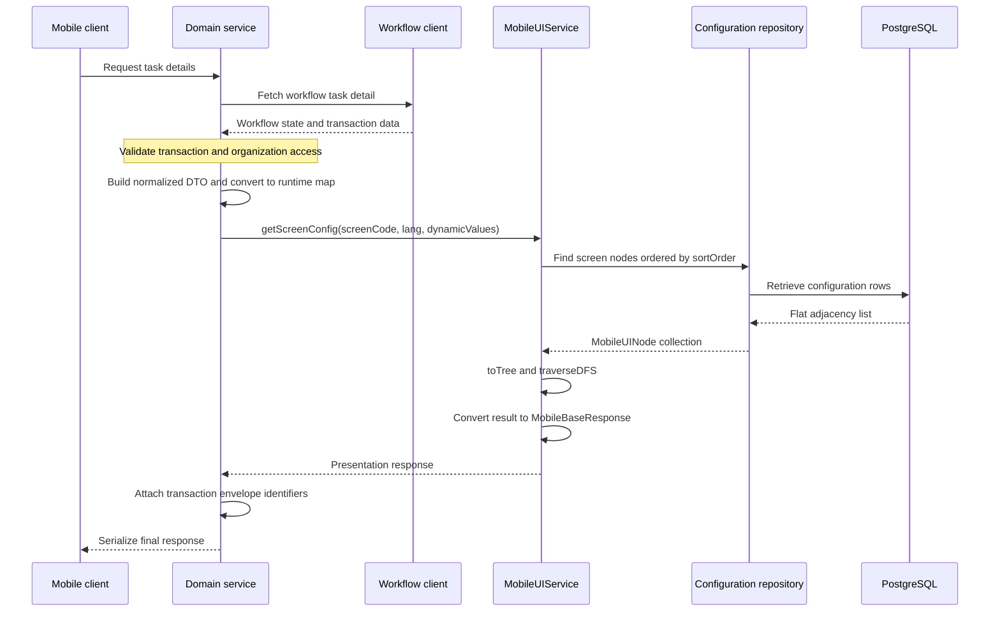

The sequence makes an important distinction: the runtime data is acquired and validated before the presentation engine receives it. Configuration must not substitute for domain authorization. In the provided rollover service, the organization validation and checks for transaction record details precede the DTO construction and presentation call.

## 5. Persistent configuration model

### 5.1 Relational adjacency list

The database migration defines a self-referencing table, `t_mobile_ui_nodes`, in which each record corresponds to one configuration node. The `parent_id` references the primary key of another row in the same table. A null parent represents a top-level node. This is the adjacency-list model, an established relational representation of hierarchical data.

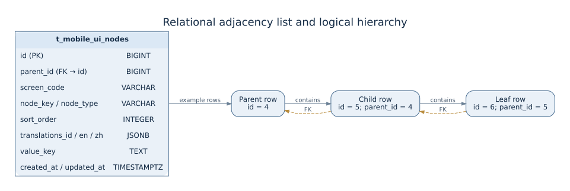

*Figure 2. A relational row carries the local parent relationship; the full hierarchy is reconstructed in memory.*

Unlike a materialized path or nested-set model, the adjacency list records local parent relationships directly. It is simple to maintain and can represent deep structures without adding a database column for each level. Its main trade-off is that the complete hierarchy must be reconstructed or recursively queried when the application needs the full tree.

| Column | SQL type | Semantics |
|---|---|---|
| `id` | `BIGINT` | Primary identifier for a presentation node. |
| `parent_id` | `BIGINT` | Nullable self-referencing parent ID. |
| `screen_code` | `VARCHAR(100)` | Logical screen namespace. |
| `node_key` | `VARCHAR(100)` | Output property name; may be null for array elements. |
| `node_type` | `VARCHAR(20)` | Interpreter dispatch type. |
| `sort_order` | `INT` | Configured relative order, default `1`. |
| `translations_id` | `JSONB` | Indonesian presentation metadata. |
| `translations_en` | `JSONB` | English presentation metadata. |
| `translations_zh` | `JSONB` | Chinese presentation metadata. |
| `value_key` | `TEXT` | Runtime value lookup reference. |
| `created_at` | `TIMESTAMPTZ` | Creation timestamp, default current timestamp. |
| `updated_at` | `TIMESTAMPTZ` | Update timestamp column with insertion default. |

<details>
<summary><b>View reconstructed DDL from the supplied migration</b></summary>

```sql
CREATE TABLE IF NOT EXISTS t_mobile_ui_nodes (
    id BIGINT PRIMARY KEY,
    parent_id BIGINT NULL,
    screen_code VARCHAR(100) NOT NULL,
    node_key VARCHAR(100) NULL,
    node_type VARCHAR(20) NOT NULL,
    sort_order INT NOT NULL DEFAULT 1,
    translations_id JSONB NULL,
    translations_en JSONB NULL,
    translations_zh JSONB NULL,
    value_key TEXT NULL,
    created_at TIMESTAMP WITH TIME ZONE DEFAULT CURRENT_TIMESTAMP,
    updated_at TIMESTAMP WITH TIME ZONE DEFAULT CURRENT_TIMESTAMP,
    CONSTRAINT fk_parent_node FOREIGN KEY (parent_id)
        REFERENCES t_mobile_ui_nodes(id) ON DELETE CASCADE
);

CREATE INDEX IF NOT EXISTS idx_mobile_ui_screen_code
    ON t_mobile_ui_nodes(screen_code);
CREATE INDEX IF NOT EXISTS idx_mobile_ui_parent_id
    ON t_mobile_ui_nodes(parent_id);
```

This reconstruction omits the original explanatory comments. The timestamp default alone does not automatically update `updated_at` on subsequent SQL updates; that behavior requires application logic or a database trigger if it is expected.

</details>

### 5.2 Hybrid relational and JSONB design

Structural identity and referential relationships belong in relational columns, while extensible presentation metadata can be stored as JSONB. For example, the translation metadata for a field may declare a localized label and reference keys used to resolve currency, flag, description, or enumeration code.

```json
{
  "label": "Amount",
  "ccy_key": "amount-ccy",
  "flag_key": "source-country"
}
```

The actual amount is not persisted within the presentation definition. It is supplied independently by the current transaction. This distinction prevents a reusable configuration record from becoming a store of transaction-specific data. JSONB allows optional metadata to evolve without creating a separate column for every presentation attribute, although the application must validate metadata types and required attributes because the shown DDL does not impose a JSON schema.

### 5.3 Scope and integrity

A self-referencing foreign key enforces global parent existence, not necessarily membership in the same `screen_code`, acyclicity, valid node semantics, or unique object member names. `ON DELETE CASCADE` can remove a subtree when a parent is deleted. This can be appropriate for hierarchical ownership but should be governed carefully because deleting a high-level node can remove much of the configuration.

The repository retrieves records using `findByScreenCodeOrderBySortOrderAsc`. Existing indexes on `screen_code` and `parent_id` support access and relationship operations. A candidate composite index on `(screen_code, sort_order, id)` may improve screen-specific ordered retrieval if the query also requests a deterministic secondary ordering. Its performance must be verified with representative PostgreSQL execution plans rather than assumed from the index definition.

## 6. Hierarchical model and node semantics

### 6.1 Formal representation

A valid screen configuration can be modeled as an ordered rooted forest $F=(V,E)$, where $V$ contains configuration nodes and $E$ contains directed parent-to-child relationships. Let $n=|V|$ and let $k$ denote the number of top-level roots. For a valid forest with $k$ connected components:

$$
|E| = n-k
$$

The service assembles top-level nodes into a `LinkedHashMap`, which creates an implicit logical root. If that synthetic root and its $k$ links are counted, the augmented graph has $n+1$ vertices and $n$ edges. The physical database records do not require a persisted root node for each screen.

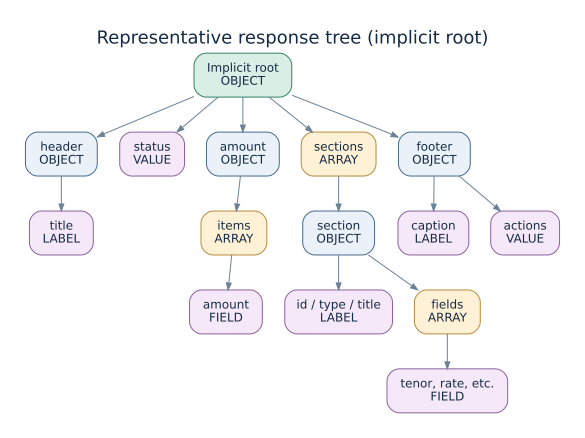

*Figure 3. Representative hierarchy. Some groups of leaves are condensed for readability; exact screen composition depends on the seed records.*

A structural node may contain other structural nodes. An object may contain an array, an array may contain objects, and those objects may contain additional arrays. This recursive composability allows one node abstraction to describe several nested response shapes. The theoretical ability to represent arbitrary finite depth is distinct from the practical depth and shape restrictions imposed by recursion, DTO conversion, and client support.

### 6.2 The five node types

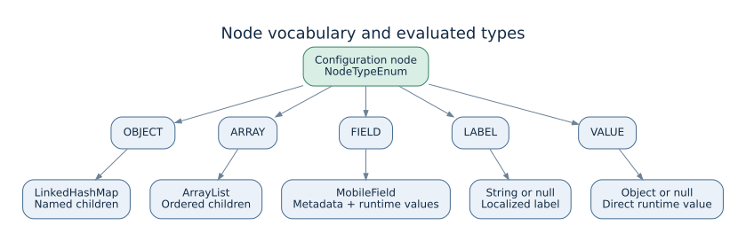

*Figure 4. The interpreter resolves each node type into a corresponding representation.*

| Node type | Resolved representation | Interpretation |
|---|---|---|
| `OBJECT` | `LinkedHashMap<String, Object>` | Evaluate named children into an ordered mapping. |
| `ARRAY` | `ArrayList<Object>` | Evaluate children into an ordered sequence. |
| `FIELD` | `MobileField` | Combine localized metadata and runtime bindings. |
| `LABEL` | `String` or null | Resolve a scalar label from selected metadata. |
| `VALUE` | Runtime `Object` or null | Retrieve an unwrapped value by `value_key`. |

`OBJECT` nodes use the child `node_key` as the map key and recursively evaluate the child. The use of `LinkedHashMap` preserves insertion order at this intermediate Java layer, but JSON object ordering is not a portable semantic contract; the client should depend on arrays when order matters. `ARRAY` nodes append recursively resolved children to an `ArrayList`. An array item does not need a property name because its identity within the resulting sequence is positional.

`FIELD` is the main integration point between translation metadata and runtime data. The selected translation map is converted into a `MobileField`, from which the builder reads labels and secondary binding references. The shown builder supplies `key`, fixed `type="text"`, label, primary value, flag, currency, code, and description. Additional display types would require corresponding interpreter and client support; they are not freely configurable in the current implementation.

`LABEL` resolves `translations.get("label")` as a string. The seed data uses this mechanism for visible titles and captions as well as stable identifiers such as section ID and type. Those structural values should remain invariant across languages. `VALUE` returns the original map entry directly rather than wrapping it in a `MobileField`, enabling status and action lists to preserve their underlying structure subject to final mapping.

<details>
<summary><b>Inspect the formal evaluation rules</b></summary>

Let $R(v,D,\ell)$ be the evaluation of node $v$ against runtime map $D$ and language $\ell$. Let $C(v)$ be the ordered children and $\tau(v)$ the node type. The semantics can be expressed as:

$$
R(v,D,\ell)=
\begin{cases}
\operatorname{Map}[(k(c),R(c,D,\ell))]_{c\in C(v)} & \tau(v)=\mathrm{OBJECT}\\
[R(c,D,\ell)]_{c\in C(v)} & \tau(v)=\mathrm{ARRAY}\\
\operatorname{Field}(v,D,L(v,\ell)) & \tau(v)=\mathrm{FIELD}\\
L(v,\ell)[\text{label}] & \tau(v)=\mathrm{LABEL}\\
D[\operatorname{valueKey}(v)] & \tau(v)=\mathrm{VALUE}
\end{cases}
$$

Here $L(v,\ell)$ selects the language-specific metadata and $k(c)$ denotes the output property key. The mathematical notation abstracts away current Java null handling and conversion exceptions. Figure 4 visualizes the same dispatch rules.

</details>

## 7. Domain integration and runtime binding

### 7.1 Rollover task details

The provided `MobileRolloverService.getTaskDetail` method retrieves workflow task details by task identifier, verifies the existence of state and detail, converts the workflow payload to `TransactionRecordGroupDTO`, and validates the transaction against the request organization. It then obtains the group detail and converts it to the expected rollover request DTO. The presence of existing and new rollover types and account data is checked before response construction.

The service builds a `RolloverTaskDetailResponse` containing the source country, approval status, formatted amount, currency, account information, tenor type, tenor display text, interest payment term, interest rate, maturity instruction descriptions and codes, reference numbers, submission information, and workflow actions. This normalized intermediate representation makes the required domain values accessible without allowing the composition engine to query the workflow or domain repositories itself.

The intermediate DTO is converted to `Map<String,Object>` by Jackson. The selected screen identifier is `rollover-detail`; the integration invokes `mobileUIService.getScreenConfig` and attaches task ID, transaction record group ID, and transaction type to the resulting typed response. The seed migration also shows configuration for `time-deposit-detail`. The observed excerpts do not establish the complete integration or behavior of every other screen.

### 7.2 Symbolic runtime binding

The runtime map acts like a limited symbol table: a symbolic name resolves to a value that exists in the current request context. Configuration uses exact references, such as `amount`, `amount-ccy`, and `source-country`, to retrieve the corresponding entries. Unlike an expression evaluator, the shown mechanism performs direct key lookups rather than executing arbitrary code or traversing arbitrary object paths.

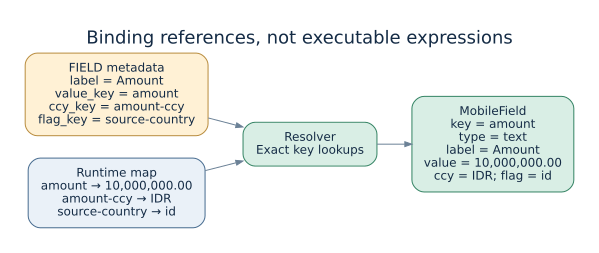

*Figure 5. A field definition provides the references; the runtime map provides the actual transaction values.*

This approach resembles late binding: the final value is determined at request time. It also resembles structural template evaluation because a persistent template and an execution context produce a concrete representation without manually concatenating JSON strings.

<details>
<summary><b>View a synthetic binding example</b></summary>

```json
{
  "status": "PENDING",
  "amount": "10,000,000.00",
  "amount-ccy": "IDR",
  "source-country": "id",
  "from": "0000000000 - IDR",
  "account-name": "Example Account",
  "tenor": "3 Months",
  "actions": ["APPROVE", "REJECT"]
}
```

The identifiers and values are illustrative, not production customer data. The `FIELD` node configured with `value_key=amount` and the metadata in Section 5 would conceptually yield:

```json
{
  "key": "amount",
  "type": "text",
  "label": "Amount",
  "value": "10,000,000.00",
  "ccy": "IDR",
  "flag": "id"
}
```

</details>

The exact naming convention between DTO serialization and configuration is a critical contract. A configured reference such as `amount-ccy` will not match a map property named `amountCcy` unless Jackson annotations or naming strategies establish that correspondence. The DTO annotations were not available for verification. A robust implementation should validate binding references against an explicit registry or contract test rather than depend on implicit agreement.

## 8. Flat-to-tree reconstruction

### 8.1 Problem and algorithm

The configuration repository returns a flat list of `MobileUINode` records. The interpreter needs a navigable hierarchy. A naive approach might scan the entire collection for each node's parent, introducing quadratic growth as the configuration expands. The implemented `toTree` method instead establishes a hash-indexed lookup before associating child relationships.

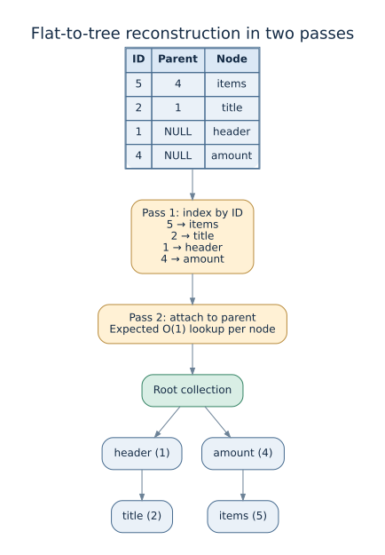

*Figure 6. The first pass builds the lookup index; the second pass attaches nodes even when a child precedes its parent in the source list.*

The first pass creates a `HashMap<Long,MobileUINode>`, initializes missing child collections, and indexes each record by its ID. The second pass retrieves the configured parent through the map and appends the child to that parent's collection. If the parent ID is null, zero, or absent from the loaded index, the implementation adds the node to the root collection. The final result is a list of root nodes.

Because the index is complete before attachment begins, reconstruction is independent of the order in which parents and children appear in the flat list. Sibling order nevertheless depends on the repository's input order, and equal `sort_order` values need a deterministic tie-breaker if relative ordering matters.

<details>
<summary><b>View simplified Java reconstruction logic</b></summary>

```java
List<MobileUINode> toTree(List<MobileUINode> flatNodes) {
    if (flatNodes == null || flatNodes.isEmpty()) {
        return new ArrayList<>();
    }
    Map<Long, MobileUINode> index = new HashMap<>(flatNodes.size());
    for (MobileUINode node : flatNodes) {
        if (node.getChildren() == null) {
            node.setChildren(new ArrayList<>());
        }
        index.put(node.getId(), node);
    }
    List<MobileUINode> roots = new ArrayList<>();
    for (MobileUINode node : flatNodes) {
        Long parentId = node.getParentId();
        if (parentId == null || parentId == 0L || !index.containsKey(parentId)) {
            roots.add(node);
        } else {
            index.get(parentId).getChildren().add(node);
        }
    }
    return roots;
}
```

This excerpt reconstructs the shown algorithm without claiming access to the complete source file. It intentionally preserves the current missing-parent and mutable-child behaviors for analysis.

</details>

### 8.2 Correctness argument and invariants

Assume unique identifiers, valid parent references within the selected screen, acyclicity, and initially empty child collections. After the first pass, every node is accessible through exactly one map key. During the second pass, every non-root node is associated with its unique parent, and every root node is inserted into the root collection. Because each row is processed once and has at most one parent, the resulting child links represent precisely the original edge set. Acyclicity guarantees that repeatedly following parents eventually reaches a root. Thus every node in the valid configuration is reachable from exactly one root.

These are preconditions for the argument, not guarantees automatically supplied by `toTree`. The current orphan promotion behavior, absence of cycle validation, and mutable child collections can invalidate the assumptions. Section 16 discusses appropriate validation controls.

## 9. Recursive depth-first interpretation

### 9.1 Traversal strategy

`traverseDFS` recursively visits a configuration node, dispatches on its type, and materializes the appropriate value. Composite nodes evaluate their descendants before the enclosing structure is returned. Terminal nodes resolve localized strings or runtime values directly.

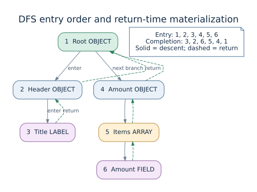

*Figure 7. Solid arrows indicate recursive descent; dashed arrows indicate completed values returning to their parent.*

It is technically imprecise to describe this mechanism as only pre-order or only post-order traversal. Type inspection and container allocation happen on entry, while composite results become complete when the recursive calls return. The approach combines top-down interpretation with bottom-up materialization.

Depth-first recursion is suitable because nested JSON-like structures naturally depend on resolved child values. A breadth-first traversal could be implemented but would require additional bookkeeping for partially materialized parent containers. A DFS visitor maps naturally to the hierarchical semantics and uses stack space related to depth rather than maximum breadth. An iterative DFS with an explicit stack is another possible design if depth is untrusted or unusually large.

### 9.2 Recursion and structural induction

The base cases are the three terminal types: `FIELD`, `LABEL`, and `VALUE`. A terminal node can be evaluated without processing structural descendants. The recursive cases, `OBJECT` and `ARRAY`, delegate the interpretation of each child to the same function and combine the returned values into a map or list.

Under a valid finite hierarchy and successful metadata conversion, correctness follows by structural induction. If the evaluation rules correctly resolve every leaf, and a composite node combines the correct results of all its children according to the declared node semantics, then the composite node is also correctly resolved. Applying this reasoning recursively establishes that all roots produce the intended intermediate representation. This does not prove compatibility with the final DTO or financial correctness of domain values; those are separate contracts.

<details>
<summary><b>View the core traversal pseudocode</b></summary>

```java
Object resolve(Node node, Map<String, Object> data, String language) {
    return switch (node.getType()) {
        case OBJECT -> {
            Map<String, Object> result = new LinkedHashMap<>();
            for (Node child : node.getChildren()) {
                result.put(child.getNodeKey(), resolve(child, data, language));
            }
            yield result;
        }
        case ARRAY -> {
            List<Object> result = new ArrayList<>();
            for (Node child : node.getChildren()) {
                result.add(resolve(child, data, language));
            }
            yield result;
        }
        case FIELD -> resolveField(node, data, language);
        case LABEL -> resolveLabel(node, language);
        case VALUE -> data.get(node.getValueKey());
    };
}
```

This is explanatory pseudocode. The actual implementation includes null checks, `NodeTypeEnum.valueOf`, `ObjectMapper`, a `MobileField` builder, and a `level` parameter. The helper names above are abstractions rather than additional methods verified in the source.

</details>

### 9.3 Trace a request :mag:

<details>
<summary><b>Step 1 — Enter the root and header</b></summary>

The root is logically an object. The interpreter descends into `header`, initializes its mapping, and reaches the `title` label. The title is localized and returned to the header, which is then returned to the root.

</details>
<details>
<summary><b>Step 2 — Evaluate the amount collection</b></summary>

The interpreter enters the `amount` object and then the `items` array. The field resolves its label, amount, currency, and flag through the current language metadata and runtime context. The array receives the completed field, and the amount object receives the completed array.

</details>
<details>
<summary><b>Step 3 — Complete the response</b></summary>

After processing all branches, the logical root is complete. The real implementation constructs this root through a top-level `LinkedHashMap`, converts it into `MobileBaseResponse`, and returns it to the domain service for envelope enrichment.

</details>

## 10. Computational complexity

### 10.1 Definitions and assumptions

Let $n$ be the number of configuration nodes, $e$ the number of parent-child edges, $h$ the maximum number of actual configuration nodes along a root-to-leaf path, $d$ the size of the normalized runtime representation, $p$ the total translation metadata processed, and $r$ the size of the materialized output. The synthetic root is excluded from $h$ in the formulas below; including it changes stack-related bounds by at most a constant in a corresponding recursive implementation.

Hash-map lookup is modeled as expected constant time under ordinary hashing conditions. The analysis assumes valid, reachable nodes, amortized constant-time list append, and no repeated reconstruction of already attached child collections. It also treats the sizes of strings, collections, and serialized structures explicitly rather than assuming every value is constant-sized.

### 10.2 Reconstruction time complexity

The first pass performs $n$ index insertions and the second pass performs up to $n$ parent lookups and attachments. Consequently, the expected structural cost is:

$$
T_{\text{tree}}(n)=\Theta(n)+\Theta(n)=\Theta(n)
$$

A naive implementation that repeatedly scans up to $n$ entries for each of $n$ nodes has a quadratic worst-case bound:

$$
T_{\text{naive}}(n)=O(n^2)
$$

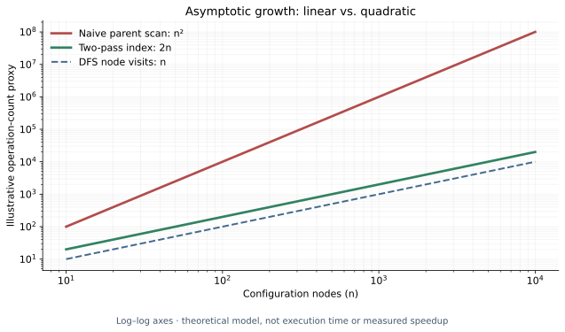

*Figure 8. Theoretical operation-count proxies on logarithmic axes. These are not measured execution times or speedup claims.*

| Node count $n$ | Quadratic proxy $n^2$ | Two-pass proxy $2n$ | DFS node visits $n$ |
|---:|---:|---:|---:|
| 10 | 100 | 20 | 10 |
| 100 | 10,000 | 200 | 100 |
| 1,000 | 1,000,000 | 2,000 | 1,000 |
| 10,000 | 100,000,000 | 20,000 | 10,000 |

The numbers deliberately represent simplified work proxies, not equivalent CPU operations. Hash lookups, object allocation, comparisons, and database I/O have different costs. The comparison demonstrates asymptotic growth, not a guarantee that one implementation is a particular number of times faster in production.

### 10.3 DFS traversal time

A conventional DFS over an adjacency representation has structural time complexity $O(n+e)$. In a valid forest, $e=n-k$, and therefore:

$$
T_{\text{DFS}}(n,e)=\Theta(n+e)=\Theta(2n-k)=\Theta(n)
$$

An equivalent recurrence for a subtree rooted at $v$ is:

$$
T(v)=\Theta(1+|C(v)|)+\sum_{c\in C(v)}T(c)
$$

The constant term represents node dispatch, and the child-count term accounts for iterating over the child collection and inserting each child result. Summing over all nodes yields one dispatch per node and a number of child-link operations proportional to $e$. Figure 7 demonstrates the recurrence visually: each branch is entered and its result is returned once in a valid hierarchy.

The full interpreter also converts translation maps, performs string conversions, and constructs response objects. Under proportional conversion costs, a more realistic expected in-memory bound is:

$$
T_{\text{composition}}=O(n+d+p+r)
$$

This is a modeling approximation rather than a universal bound on arbitrary custom Jackson serializers, getters, or external dependencies. Large nested values, custom conversions, repeated expansion of shared input objects, and response serialization may change the cost characteristics.

### 10.4 Memory and recursion depth

The reconstruction index and child collections require $O(n)$ additional structural space. DFS uses $O(h)$ recursive stack space. The normalized runtime data and materialized output require space proportional to their sizes. A simplified total working-set model, including metadata loaded into memory, is:

$$
S_{\text{working}}=O(n+d+p+r+h)
$$

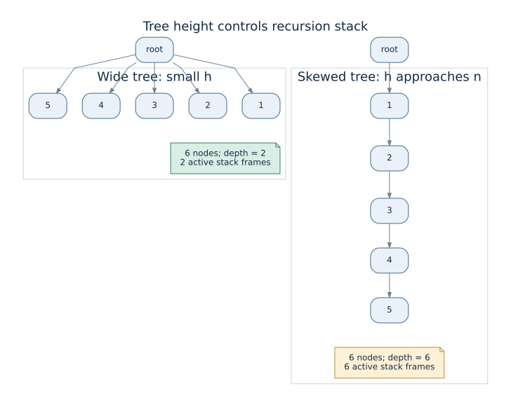

*Figure 9. Two trees with the same number of nodes can have different maximum active recursion depths.*

A wide, shallow tree can contain many nodes with relatively few active call frames. A skewed tree can have $h\approx n$, so recursion can become a practical failure risk before node count alone becomes problematic. The current traversal increments a `level` parameter but no enforced maximum depth is visible. Any operational limit should be selected using expected configuration sizes, JVM stack characteristics, and testing.

### 10.5 End-to-end cost

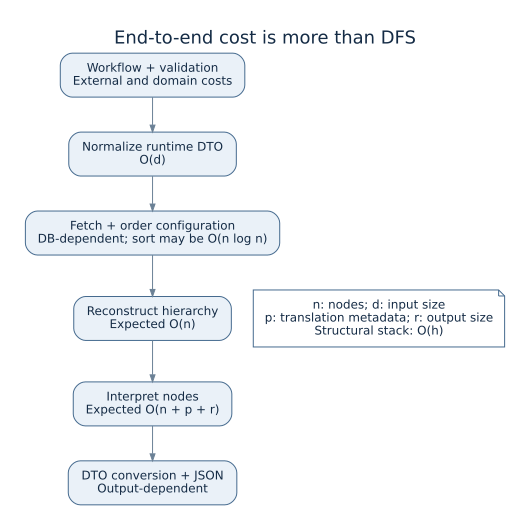

*Figure 10. Structural processing is only one component of overall request cost.*

The repository must retrieve and order database rows. Depending on indexing and the execution plan, sorting $n$ selected rows may add an $O(n\log n)$ comparison-sort component. Network latency, workflow processing, database driver overhead, Jackson conversion, and JSON serialization all influence real request latency.

$$
\begin{aligned}
T_{\text{request}}={}&T_{\text{workflow}}+T_{\text{validation}}+T_{\text{normalize}}\\
&+T_{\text{db}}+T_{\text{tree}}+T_{\text{DFS}}\\
&+T_{\text{DTO conversion}}+T_{\text{serialize}}.
\end{aligned}
$$

This equation describes the conceptual sequential stages shown in the supplied implementation, not measured timing. Real systems may overlap operations or add framework overhead. Performance evaluation should focus on actual bottlenecks rather than treating linear traversal complexity as proof of endpoint throughput.

## 11. Internationalization and localization

### 11.1 Language selection

The `getTranslation` method selects `translations_id` for `id`, `translations_zh` for `zh`, and `translations_en` for other values, including null and unsupported identifiers. The supplied code normalizes the selector with `toLowerCase()` before dispatch. This is a language-selection default, not a complete per-node fallback policy: a missing Indonesian or Chinese metadata object is not visibly resolved through a secondary English lookup.

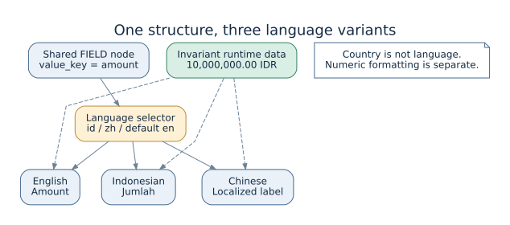

*Figure 11. Localization selects presentation metadata while retaining the underlying symbolic binding.*

| Stable key | English (`en`) | Indonesian (`id`) | Chinese (`zh`) |
|---|---|---|---|
| `amount` | Amount | Jumlah | 金额 |
| `tenor` | Term | Tenor | 存期 |
| `interest-rate` | Interest Rate | Suku bunga | 利率 |

The Chinese and other display examples are representative; their exact translations should be checked against approved product terminology. Stable keys and business identifiers should remain invariant unless the API contract explicitly says otherwise.

<details>
<summary><b>English response example</b></summary>

```json
{"key":"amount","type":"text","label":"Amount","value":"10,000,000.00","ccy":"IDR"}
```

</details>
<details>
<summary><b>Indonesian response example</b></summary>

```json
{"key":"amount","type":"text","label":"Jumlah","value":"10,000,000.00","ccy":"IDR"}
```

</details>
<details>
<summary><b>Chinese response example</b></summary>

```json
{"key":"amount","type":"text","label":"金额","value":"10,000,000.00","ccy":"IDR"}
```

</details>

### 11.2 Language, country, and locale are different concepts

The rollover integration passes the normalized `sourceCountry` as the second argument to `getScreenConfig`, which interprets that parameter as a language identifier. This may reflect an intentional upstream business convention, but it cannot be assumed to represent an independent user language preference. Country identifies geographical or transaction context; language identifies a communication preference; locale can express language, region, and associated formatting conventions. An Indonesian transaction can legitimately be displayed in English, and Chinese can be used in multiple countries.

The proposed design should separate `countryCode`, `languageCode`, and `locale`. Locale parsing could support standardized tags such as `id-ID`, `en-SG`, and `zh-Hans`, with an explicit fallback chain and locale-independent identifier normalization. This is a recommendation; the supplied implementation directly matches `id` and `zh` and otherwise selects English.

### 11.3 Labels are only part of localization

Internationalization (i18n) prepares software to support multiple languages and locales. Localization (l10n) adapts a particular experience to a target language or locale. The implementation establishes centralized label localization but does not demonstrate comprehensive formatting and terminology localization.

For example, the rollover domain builder contains English phrases such as `Upon maturity` and `Every`, produces tenor descriptions through domain methods, and appends interest-rate text. The amount builder also appends a fixed `.00` suffix to a formatted value. These may be appropriate under specific product and formatter assumptions, but they should not be treated as general locale-aware monetary formatting. Financial amounts should preferably remain exact numeric values with an explicit currency, then be formatted according to approved currency precision and presentation rules. Locale-sensitive date formatting, pluralization, number separators, enum descriptions, and time zones require their own policy.

The structural metadata could be extended with formatter identifiers and stable translation resource keys. Non-linguistic references such as `ccy_key`, `flag_key`, and `desc_key` could be separated from translated metadata to avoid duplication and accidental divergence between language variants. For a small fixed language set, the current columns are workable; for broader locale support, a locale-keyed dictionary or a normalized `(node_id, locale)` translation table may be preferable.

## 12. Representative output and contract boundaries

The example below illustrates the resulting composition for a rollover detail screen. Exact null omission, JSON property names, enum values, DTO conversions, and serialization behavior depend on code and configuration not fully visible in the supplied excerpts.

<details open>
<summary><b>Representative localized JSON response</b></summary>

```json
{
  "header": {"title": "Time Deposit (Change instruction)"},
  "status": "PENDING",
  "amount": {
    "items": [
      {"key": "amount", "type": "text", "label": "Amount", "value": "10,000,000.00", "ccy": "IDR", "flag": "id"}
    ]
  },
  "sections": [
    {
      "id": "general",
      "type": "field-group",
      "fields": [
        {"key": "from", "type": "text", "label": "From", "value": "0000000000 - IDR", "description": "Example Account"}
      ]
    },
    {
      "id": "deposit-details",
      "type": "field-group",
      "title": "Deposit details",
      "fields": [
        {"key": "tenor-type", "type": "text", "label": "Term type", "value": "MONTH"},
        {"key": "tenor", "type": "text", "label": "Term", "value": "3 Months"},
        {"key": "interest-term", "type": "text", "label": "Interest to be paid", "value": "Upon maturity"},
        {"key": "interest-rate", "type": "text", "label": "Interest Rate", "value": "4.5% p.a."},
        {"key": "rollover-type", "type": "text", "label": "Current maturity instructions", "value": "Renew principal", "code": "EXAMPLE_CURRENT"},
        {"key": "new-rollover-type", "type": "text", "label": "New maturity instructions", "value": "Renew principal and interest", "code": "EXAMPLE_NEW"}
      ]
    },
    {
      "id": "additional-details",
      "type": "field-group",
      "title": "Additional details",
      "fields": [
        {"key": "customer-reference", "type": "text", "label": "Reference no.", "value": "EXAMPLE-REF"},
        {"key": "bank-reference", "type": "text", "label": "Bank reference no.", "value": "EXAMPLE-BANK-REF"},
        {"key": "submitted-by", "type": "text", "label": "Submitted by", "value": "Example User"}
      ]
    }
  ],
  "footer": {
    "caption": "Please ensure data is correct before approving",
    "actions": ["APPROVE", "REJECT"]
  }
}
```

The domain envelope is omitted here to emphasize configurable presentation. The shown domain method separately attaches task and transaction identifiers. Synthetic status, codes, actions, references, and amounts are not verified production values.

</details>

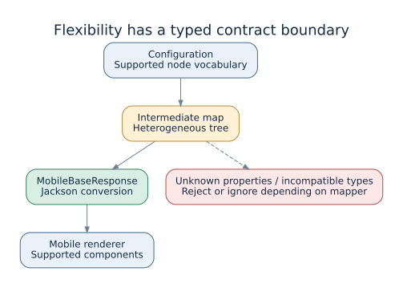

*Figure 12. The intermediate representation is flexible, but the typed conversion and client component vocabulary constrain the delivered response.*

The use of `ObjectMapper.convertValue(result, MobileBaseResponse.class)` establishes a deliberate or incidental type boundary. Unknown properties may be ignored or rejected depending on the actual Jackson configuration and DTO annotations. Invalid value types may fail conversion, and supported client components may have their own restrictions. Thus the phrase “without backend deployment” is valid only for compatible configuration changes and only when an authorized runtime configuration publishing process is available.

## 13. Software engineering principles

### 13.1 Separation of concerns and cohesion

The domain service and response composition engine have distinct reasons to change. Domain services evolve when transaction rules, workflow integrations, or validation requirements change. Configuration evolves when supported presentation structure or terminology changes. The interpretation engine evolves when the node vocabulary or composition semantics change. This separation improves cohesion by centralizing shared presentation-related operations in one service.

The Single Responsibility Principle is applicable at the service boundary, although `MobileUIService` currently combines retrieval, reconstruction, translation selection, interpretation, and conversion. These responsibilities may remain cohesive for a small service. Further decomposition should depend on actual growth, testability, and change frequency rather than creating additional abstractions merely to satisfy a pattern name.

### 13.2 Open-Closed Principle and design patterns

The design partially satisfies the Open-Closed Principle because new screen definitions using existing node types and available runtime bindings can be added without rewriting DFS. However, adding new node types requires modifications to the enum and switch logic, and new business values may require domain changes. The boundary between configuration-level extension and code-level extension should therefore remain explicit.

The hierarchy exhibits Composite pattern characteristics through its uniform representation of terminal and composite nodes. The implementation is not a strict polymorphic Composite because behavior is dispatched by an external switch. Likewise, the node vocabulary and evaluation behavior exhibit Interpreter pattern characteristics, without constituting a general-purpose language interpreter. A Strategy or registry-based resolver design could be introduced later if additional node types make the switch difficult to maintain.

### 13.3 Coupling is transformed rather than eliminated

The architecture reduces direct coupling between domain services and nested presentation builders but creates dependencies between runtime key names, configuration metadata, response DTO shapes, and client component support. These are legitimate interfaces, provided that they are versioned and tested. Dynamic configuration without explicit contract validation simply relocates failures from compile time to runtime. The architectural goal is to make presentation variability more manageable, not to remove all constraints.

## 14. Architectural alternatives and trade-offs

| Dimension | Static DTO builders | Adjacency-list interpreter | Whole-screen JSONB document |
|---|---|---|---|
| Structural representation | Java code | Relational nodes | Nested document |
| Compile-time structural checks | Stronger | Reduced | Reduced |
| Read-time reconstruction | Not required | Two-pass index | Already nested |
| Node-level identity | Application-defined | Natural primary key | Must be modeled |
| Atomic screen versioning | Application release | Requires design | Natural document boundary |
| Independent label updates | Usually code/resource updates | Possible with governance | Possible with governance |
| Validation effort | Compiler and tests | Graph, metadata, binding and contract | Schema, binding and contract |

Static mapping remains appropriate for simple, stable screens. It is direct to inspect and provides stronger compiler support. A single JSONB document is an alternative when screens are normally retrieved and published as a complete aggregate; it can simplify atomic versioning and avoid flat-to-tree reconstruction, though granular node relationships and updates become more application-dependent.

The current adjacency-list approach is defensible when independently identified configuration nodes, parent-child relationships, and targeted node updates are meaningful requirements. It also provides a natural basis for node-level metadata analysis and administration. The appropriate model should be evaluated against publishing frequency, typical screen size, concurrent editing requirements, audit needs, and retrieval patterns.

Generic maps offer intermediate structural flexibility at the expense of compile-time type safety. The final DTO conversion is therefore valuable but insufficient as the only validation mechanism. Ideally, invalid configurations should be rejected before activation rather than discovered by end users during transaction approval.

## 15. Scalability and performance

### 15.1 Structural, product, and language scalability

The reusable interpreter can process more supported nodes and product configurations without a separate structural algorithm for every product. Product services still need to prepare appropriate domain data and satisfy the runtime binding contract. Adding a new language is currently less flexible because both schema columns and language selection logic explicitly represent a small language set.

Structural scalability refers to how processing grows as the configuration becomes larger. Throughput scalability is a different concern: it depends on request concurrency, CPU and heap utilization, database load, network latency, external service latency, and serialization. No measured improvement is available from the supplied excerpts. The theoretical analysis justifies the structural algorithm, not a specific production throughput claim.

### 15.2 Configuration caching

The current `getScreenConfig` retrieves configuration and reconstructs its hierarchy on invocation. Since presentation definitions are typically less volatile than transaction data, a future optimization could cache a validated, immutable tree by `screen_code` and configuration version. If the cached artifact is locale-specific, the locale should also form part of its key. The cached representation should contain no user-specific business values or authorization outcomes.

Caching raw mutable nodes would be risky because `toTree` appends children to existing collections. Reconstructing the same instances repeatedly could duplicate child links, and sharing a mutable hierarchy across requests could produce race conditions. A safer design constructs a separate immutable configuration snapshot before caching. Cache invalidation must correspond to version publication, and each request should evaluate its own runtime map independently.

## 16. Production hardening

> [!WARNING]
> A successful database migration and a linear DFS algorithm do not guarantee a valid financial presentation. Invalid references, missing required values, localization errors, or incompatible configuration can silently produce misleading approval information. Treat configuration as a controlled application artifact.

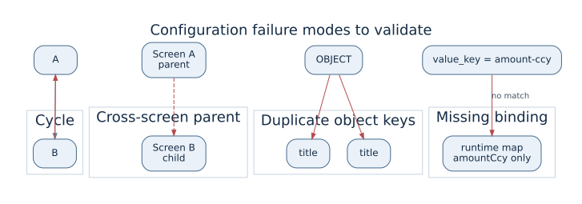

*Figure 13. A self-referencing foreign key is necessary for basic referential integrity but does not enforce every application-level invariant.*

### 16.1 Graph validation and structural safety

A self-referencing foreign key permits relationships that are globally valid but logically invalid for the selected screen. In the shown `toTree` behavior, an absent parent in the loaded index causes the child to be promoted to root. A cross-screen parent can therefore become an unexpected top-level component. Prefer rejecting this condition explicitly unless orphan promotion is a documented requirement.

Cycles are also not independently prevented by the shown DDL. In a strict single-parent graph, a cyclic component is disconnected from legitimate roots, so the current root-only traversal can omit that component silently. In malformed in-memory structures where a cycle becomes reachable, recursion may fail to terminate. Validate all configuration nodes before traversal, not only those reachable from roots.

A three-state DFS validator can track unvisited, visiting, and visited states. Encountering a visiting node indicates a back edge and a cycle. Iterating all components ensures disconnected cycles are detected. The structural validation cost remains $O(n+e)$, and its state map requires $O(n)$ space. Additional rules should reject children attached to terminal nodes, unsupported node types, invalid object keys, duplicate sibling object keys, incompatible root definitions, and excessive depth or node count.

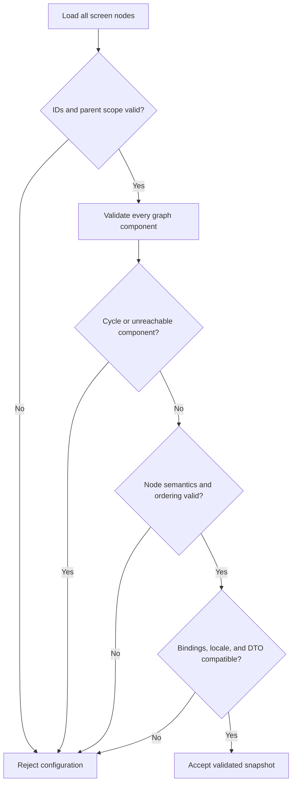

*Proposed validation flow; not shown in the existing implementation.*

### 16.2 Runtime binding and missing metadata

`getStringValue` returns null when the runtime map or key is null, missing, or maps to null. This is appropriate for optional fields but can conceal missing mandatory values. Required and optional bindings should be distinguished. A required financial value or currency should fail with a controlled domain or configuration error rather than disappear silently.

The `FIELD` interpreter converts selected translation metadata into `MobileField`, then dereferences the resulting object. If the selected metadata is null, a null converted object can cause a null-pointer failure. A missing `label` in a non-null translation map can become the literal string `"null"` through `String.valueOf`. Unsupported node type strings can cause enum conversion failures. Each condition should be recognized and reported through predictable validation or error handling.

`getScreenConfig` returns null for an empty configuration. The demonstrated domain service subsequently calls setters on that response, so a missing definition may result in a null-pointer exception unless a guard elsewhere prevents it. A dedicated configuration-not-found exception would preserve a clearer failure boundary.

### 16.3 Ordering and determinism

The database query sorts by `sort_order`, but ties are not visibly resolved using another key. Siblings with duplicate positions may appear in an unspecified relative order, especially when database execution plans change. Deterministic ordering can be achieved through unique sibling positions or a documented tie-breaker such as `id` in the query. Root properties and object child keys should also be validated to prevent silent overwriting by `Map.put`.

### 16.4 Production risk register

| Risk | Consequence | Recommended mitigation |
|---|---|---|
| Cycles or unreachable nodes | Omitted branches or nonterminating recursion in malformed graphs | Validate every graph component. |
| Cross-screen parent | Unexpected root or response structure | Require parent scope to match. |
| Duplicate object keys | Silent overwrite | Enforce per-object key uniqueness. |
| Duplicate sort positions | Unstable field sequence | Deterministic ordering rules. |
| Missing translation | Null or misleading label | Required metadata and per-node fallback. |
| Unknown runtime binding | Missing financial information | Binding allowlist and required-value validation. |
| Country used as language | Incorrect user language | Separate language, country, and locale. |
| Fixed field type | Unsupported UI variants | Explicit supported component registry. |
| Unbounded recursion | Stack or resource exhaustion | Validate maximum depth and size. |
| Mutable shared nodes | Duplicate links or concurrency errors | Immutable configuration snapshots. |
| Incompatible DTO | Conversion failures or lost properties | Pre-publication contract validation. |
| Missing screen definition | Null-pointer exception | Controlled configuration error. |

## 17. Security and financial integrity

The configuration interpreter must not participate in authorization decisions. The supplied rollover flow obtains permitted workflow actions from the workflow response and validates organizational access before presentation construction. The action endpoint must independently revalidate authorization, transaction state, and business rules at execution time. Displaying an `APPROVE` button is not an authorization grant.

The runtime map should contain only data approved for presentation. A dynamic binding reference can expose any available map entry, so expanding the map indiscriminately increases exposure risk. A screen-specific allowlist or typed binding context can constrain which values are accessible. Credentials, sensitive internal metadata, unrelated customer attributes, and confidential transaction details should never be provided to a generic renderer without a justified presentation requirement.

Configuration writes require strong access controls and review because seemingly cosmetic changes can mislead a financial decision. Incorrect maturity instructions, mislabeled currencies, or swapped old and new values could affect user consent and approval even if transaction-processing code remains correct. Audit records should capture the configuration version, change author, approval, and activation event without logging sensitive customer values.

## 18. Testing and verification

Testing should establish both the correctness of the interpreter and the correctness of configured screen contracts. Unit tests can exercise the five node types, hierarchy reconstruction, null handling, and locale selection independently. Integration tests should run against a representative PostgreSQL configuration to verify the migration, row ordering, repository access, metadata conversion, and final typed response. Contract tests should validate generated JSON against the client's accepted structures and verify that required field identities and actions remain stable across translations.

Property-based testing is particularly useful for structural algorithms. Randomly generated valid forests can be shuffled and reconstructed, then checked for exact preservation of parent-child relationships and reachability. Separate invalid examples should cover cycles, missing parents, duplicate object keys, terminal nodes with children, and excessive depth. Because source ordering is meaningful for arrays, any shuffle-based test should restore the intended order or test only structural relationships, not inadvertently assert that arbitrary input order preserves presentation order.

Multilingual tests should confirm that changing the selected language affects intended presentation metadata without changing the semantic identity of amounts, transaction IDs, business status, or actions. They should additionally detect fixed English domain strings and inconsistent translation reference keys. Financial formatting should be tested at relevant currency precisions and boundary values. Performance tests should measure separate stages, include shallow and skewed configurations, and record throughput, latency percentiles, allocation behavior, and database workload.

<details>
<summary><b>Proposed verification checklist</b></summary>

- [ ] Unit tests cover every supported `NodeTypeEnum` value.
- [ ] Parent order independence and sibling ordering are verified.
- [ ] Missing screen, invalid enum, missing translation, and binding errors are controlled.
- [ ] All graph components are checked for cycles and parent scope.
- [ ] Synthetic fixtures verify each supported locale.
- [ ] Contract tests cover rollover and placement configurations and other supported screens.
- [ ] Workflow actions remain subject to independent endpoint authorization.
- [ ] No unauthorized runtime map values are exposed through configuration.
- [ ] Large and skewed hierarchies are covered by performance and resilience tests.
- [ ] Production baselines are recorded before claiming performance improvements.

This checklist represents recommended acceptance criteria, not verified completed work.

</details>

## 19. Configuration governance and observability

### 19.1 Publishing and rollback

The supplied schema contains timestamps, and the initial configuration is delivered through SQL migration scripts. This supports reproducible initial configuration but does not demonstrate a standalone publishing process. If updates continue to be delivered only through migrations, layout changes may still require a database release. A versioned configuration lifecycle could enable safer independent publication within the supported contract.

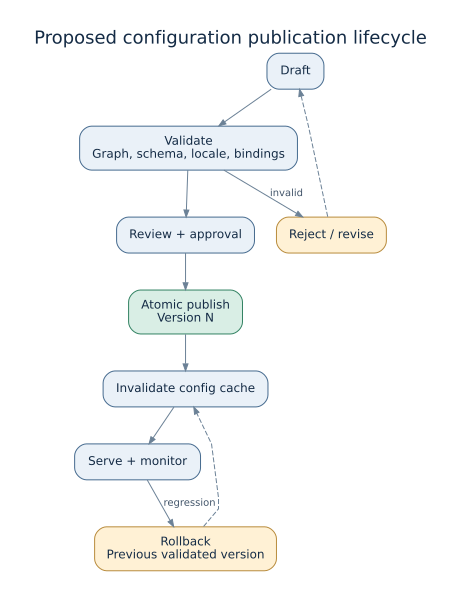

*Figure 14. Proposed future configuration management lifecycle, not an existing workflow.*

A candidate screen version should be created as a draft, validated as a complete aggregate, reviewed, and published atomically. Activation should invalidate or refresh caches consistently across instances. Rollback should restore a previously validated configuration version without modifying transaction data. Version identity, client compatibility, and translation coverage should be recorded with the published snapshot.

### 19.2 Operational diagnostics

Failures in a configuration-driven system can occur after compilation and deployment, so observability must distinguish presentation failures from business-service failures. Structured diagnostics can include screen code, configuration version, requested locale, node ID, node type, unresolved key, and processing stage. Transaction values, account information, or customer identifiers should not be written to diagnostic logs unnecessarily.

Useful measurements include configuration retrieval latency, reconstruction time, interpretation time, conversion failures, cache hit ratio, missing binding frequency, translation fallback frequency, invalid configuration attempts, and overall response latency. Tracking latency percentiles by screen and configuration version can help identify regressions. These metrics are recommended instrumentation; their existence and measured values have not been established by the source material.

## 20. Evolution roadmap and conclusion

A pragmatic evolution should begin with contract and integrity safeguards rather than adding expressive configuration features prematurely. First, validate screen-scoped relationships, required translations, runtime bindings, deterministic ordering, and response compatibility. Next, separate requested language from transaction country and address locale-sensitive formatting. Once correctness is established, introduce immutable configuration snapshots, measurable caching, and versioned publication where operational requirements justify them.

If the interpreter grows substantially, a resolver registry could separate each node strategy into a dedicated component. Configuration loading, validation, hierarchy compilation, locale resolution, field binding, and response mapping could be independently testable. Conditional presentation, formatter selection, reusable components, and client compatibility negotiation are possible later extensions, but they should not turn the configuration into a second uncontrolled business programming language.

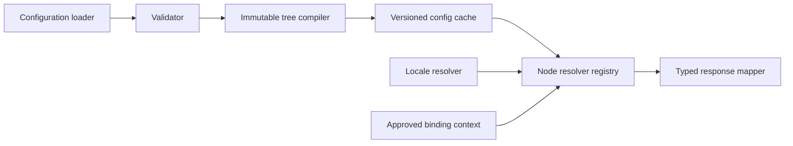

*Proposed decomposition for a larger implementation; current behavior remains centralized in `MobileUIService`.*

The architecture's principal achievement is the separation of supported presentation variability from transaction-specific processing through a declarative hierarchical model. It combines relational adjacency lists, hash-indexed reconstruction, recursive depth-first interpretation, localized metadata, and runtime symbolic binding to compose consistent mobile responses. Its structural processing is expected linear in node count under the stated validity and hashing assumptions, while its complete runtime cost is influenced by data conversion, database operations, output size, and external services.

The long-term value of the system depends on maintaining a disciplined boundary between configuration and business logic. When paired with rigorous contract validation, appropriate localization, secure binding, deterministic ordering, observability, and controlled publication, this architecture offers a credible foundation for a reusable enterprise presentation composition engine.

---

### Appendix — terminology and reading guide

| Term | Meaning in this implementation |
|---|---|
| Adjacency list | Relational parent references representing the hierarchy. |
| Ordered forest | Multiple top-level nodes, with an implicit response root. |
| DFS | Depth-first recursive structural evaluation. |
| Runtime binding | Exact-key lookup in a normalized business map. |
| i18n / l10n | Internationalization / adaptation to a specific locale. |
| SDUI | Server-driven UI principles within a predefined client contract. |
| Metadata | Persistent descriptors controlling supported presentation. |
| Typed boundary | Conversion into `MobileBaseResponse` and client contract constraints. |
| Configuration snapshot | Proposed immutable, validated version of a screen. |

<details>
<summary><b>Source basis and rendering notes</b></summary>

**Implementation evidence:** Supplied screenshots of the merge request summary, hierarchy sketch, change description, Java domain service, `MobileUIService`, database DDL, and SQL seed migrations. No production benchmark or complete repository was supplied. All diagrams in this document are original reconstructions or explicitly marked proposals, not screenshots of production data.

**GitHub rendering references:** [Basic writing and formatting syntax][gh-basic] and [Advanced formatting][gh-advanced]. Mermaid diagrams, mathematical expressions, alert blocks, relative image paths, expandable sections, tables, syntax-highlighted code, and task lists are included to aid navigation and inspection. Other Markdown renderers may not support every extension.[^rendering]

The visual assets are supplied in SVG and PNG formats. SVG is referenced by default for scalable rendering; PNG is available for platforms that do not render SVG. The included Python/Graphviz generation script makes the figures reproducible and editable. No external image hosting is required.

</details>

[Return to navigation](#navigation) · [Return to top](#database-driven-multilingual-response-composition)

[gh-basic]: https://docs.github.com/en/get-started/writing-on-github/getting-started-with-writing-and-formatting-on-github/basic-writing-and-formatting-syntax
[gh-advanced]: https://docs.github.com/en/get-started/writing-on-github/working-with-advanced-formatting
[^rendering]: GitHub Markdown functionality varies by surface and platform. In particular, footnotes may not render in wikis, and other hosts may render Mermaid, math, or alerts differently. The static figures provide a portable alternative for the major concepts.
